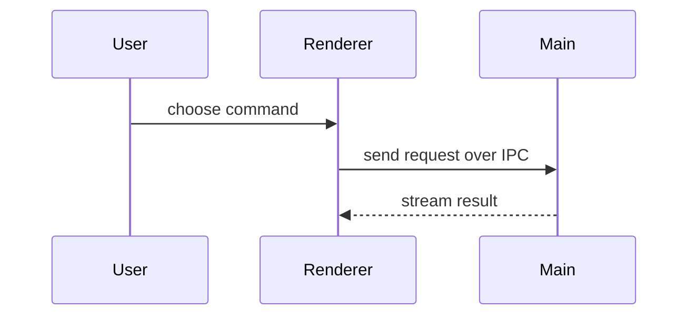

# Create a PR

## 1. Lower the merge risk first

Before opening the PR, suggest running the `merge-risk` skill on the branch, and run it unless the user declines. Then close the gaps it finds, as long as the fix doesn't change what the PR does:

- **Verification:** capture before/after screenshots or a recording of user-visible changes (see `test-desktop-app`), add tests for untested edge cases, and profile changes that could affect performance.
- **Impact:** document assumptions and drive-bys, and pull unrelated changes out of the branch.
- **Rollback cost:** make one-way doors reversible where you can (keep old data readable, put destructive steps behind a flag).
- **Error detection:** surface swallowed errors and fallbacks that would hide a breakage.

Ask the user before closing a gap that would change the PR's behavior or scope. Tell the user the final risk level and anything you couldn't mitigate.

## 2. Record the change

Run the `changelog` skill before or right after opening the PR.

## 3. Write the body

Use `.github/pull_request_template.md`. Delete its HTML comments and any checklist items that don't apply. Skip preambles, keep prose brief, and use the domain language from `CONTEXT.md`. Fill each section from what `merge-risk` found.

### Summary

One or two sentences, then the smallest view that makes the key point clear. Usually one visual; several only when each answers a different question. Place each visual next to the short text it supports, and keep only the calls, files, props, states, and boundaries a reviewer needs.

- Logic or an algorithm as pseudocode:

```text
on(save)
  if content is unchanged
    return cached result
  write new content
  return fresh result
```

- Runtime control flow as a call tree:

```text
submitForm
  createSession
    persistPrompt
    launchAgent
  navigateToSession
```

- UI structure as a component tree, including the state and module boundaries that matter:

```text
<SessionPage> (apps/desktop/src/routes/session.tsx)
  useSessionEvents()
  <SessionToolbar>
    <RunSkillButton> (packages/ui)
```

- File responsibility or a broad refactor as a shallow file tree:

```text
src/
├── commands/       # parses user actions
├── sessions/       # owns session state
└── transport/      # sends API requests
```

- Component interaction, control flow, or data flow as Mermaid:



- A `diff` when the point is what changes and the surrounding shape already exists. Match the diff to the topic (component tree, file tree, call tree, or control flow):

```diff
 <SessionPage>
   useSessionEvents()
   <SessionToolbar>
+    <RunSkillButton />
   <SessionTimeline>
+    <SkillResultCard />
```

- The whole block when most of it is new, when omitted context would hide ownership or order, or when the reviewer needs a copyable target shape.

### Verification

Show a before and after. For changes to the user experience, the reviewer expects visual evidence: screenshots or a screen recording from the running app. `gh` can't upload images, so save them, list their paths, and ask the user to drag them into the PR. Without a visual change, show the exact test or command that failed before and passes now (pseudocode is fine). List the edge cases you tested and any you didn't.

### Impact

What this PR touches and who would notice if it broke: screens, flows, platforms, file formats, shared packages. Name any sensitive area it touches (file system access, auth, data migrations, dependency bumps, build or release config) and anything that widens access or weakens validation.

### Rollback

The exact procedure to undo this PR during an incident, as numbered steps someone else could follow. Say whether it's a two-way door (revert and release) or a one-way door. For a one-way door, list what a revert won't undo (rewritten files, migrated settings, published packages) and how to recover from it.

## 4. Open the PR, then suggest a stack

After opening the PR, check whether splitting it into stacked PRs would shrink the blast radius or make review easier, e.g. a refactor that can land before the behavior change, or independent pieces touching different areas. If so, tell the user how you'd split it. Don't restack without their go-ahead.
