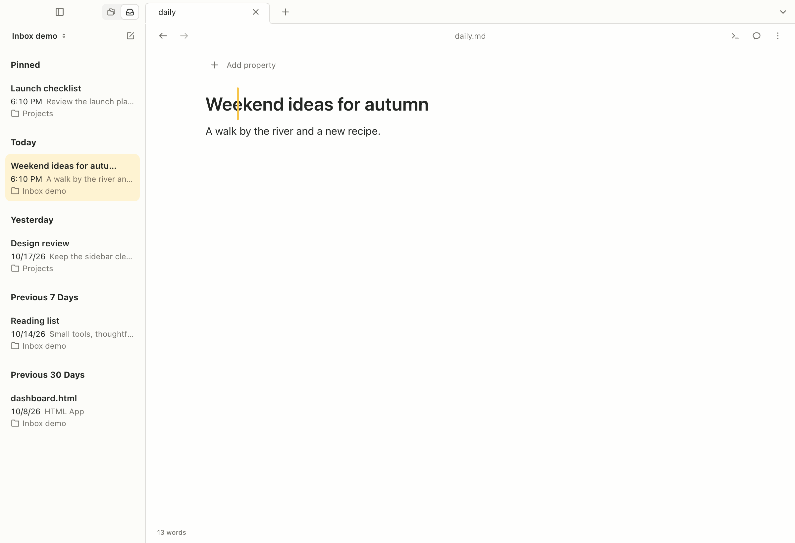
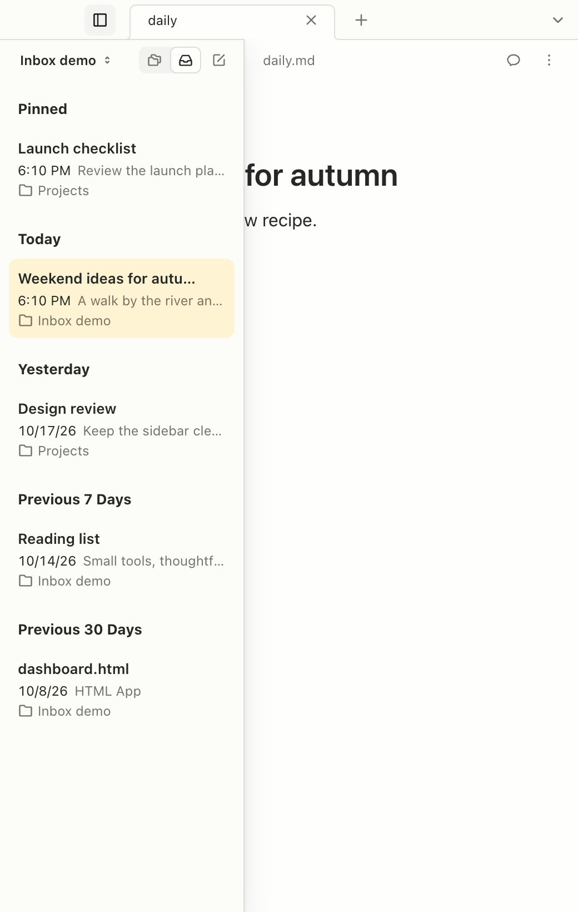
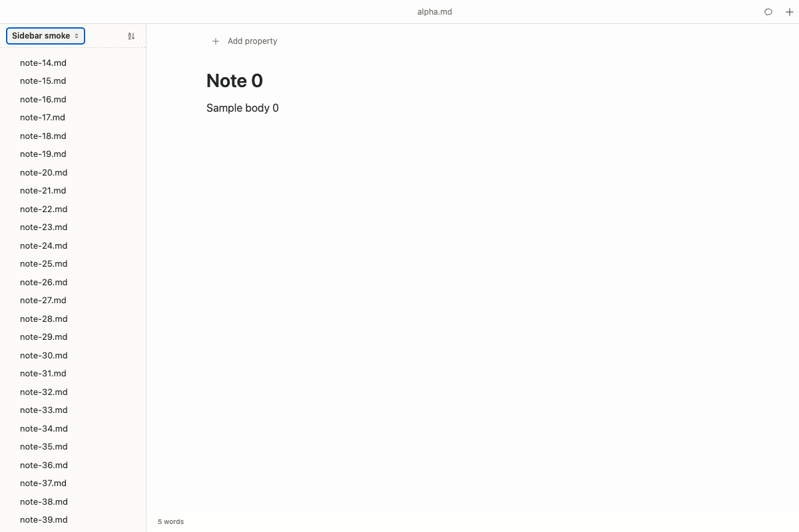
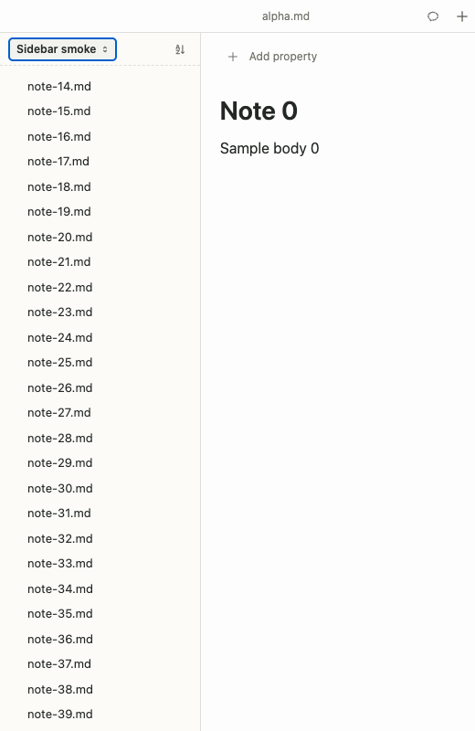

# Inbox and sidebar validation

Captured from PR #307 on October 18, 2026, using generated notes and an isolated desktop user profile.

## Desktop inbox

The Electron E2E test exercises pinned notes, Today / Yesterday / Previous 7 Days grouping, HTML App previews, opening a note, arrow-key navigation, live title updates, and the compact drawer closing after a note opens. It waits for the drawer to finish opening before taking the compact screenshot.

| Wide window (1200 × 820) | Compact window (520 × 820) |
| --- | --- |
|  |  |

## Web sidebar

The browser smoke test loads the production `apps/www` bundle, with mocked Convex HTTP responses and an isolated WebSocket route. It verifies clicking files, selection after direct URL navigation, expanding a folder and opening its note, sorting, the workspace menu, scrolling, and the sidebar at 520 px. No live sync server or user workspace is involved; this does not validate live sync.

The smoke test exposed existing drag attributes marking otherwise clickable rows and folder labels as disabled. Drag attributes now appear only when dragging is available, with regression coverage for opening files without drag support.

| Wide web view | Narrow web view |
| --- | --- |
|  |  |

## Preview recovery

- File read or access failures return `null`, distinct from an empty note.
- IPC rejection marks that batch failed and continues with later batches.
- The inbox shows a failure message and a Retry previews button; notes remain openable.
- Retry rereads failed or changed notes, preserves saved previews, and is disabled while reads are pending.
- Regression tests cover IPC rejection, partial failure, an empty note, preserving saved previews, retrying without file changes, pending retries, and continuing past a failed batch. Main-process tests cover retrying a previously missing file.

## Reproduce

From the repository root:

```sh
pnpm build:desktop
pnpm check:react-compiler
pnpm check
pnpm test
pnpm --filter @hubble.md/desktop exec playwright test
pnpm --filter @hubble.md/desktop exec playwright test --config playwright.web.config.ts
```

The web smoke config builds the web app and starts a local preview server. Install Playwright Chromium first, or set `PLAYWRIGHT_CHANNEL=chrome` to use installed Chrome in an isolated profile.

This run used Node 25.8.2. Unit tests used `NODE_OPTIONS=--no-experimental-webstorage` to avoid Node 25's incompatible built-in `localStorage`; CI uses Node 22.13.0. All 626 unit tests (120 editor, 199 shared UI, 307 desktop), five desktop E2E flows, the web sidebar smoke test, formatting checks, and production React Compiler audits passed.
