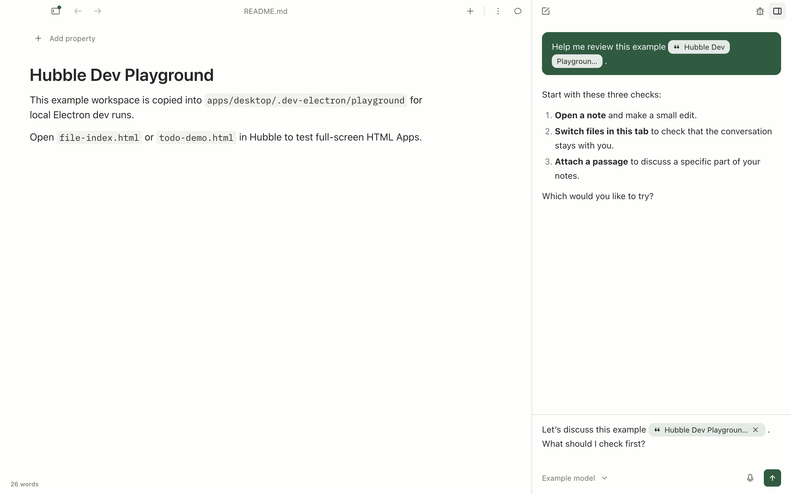
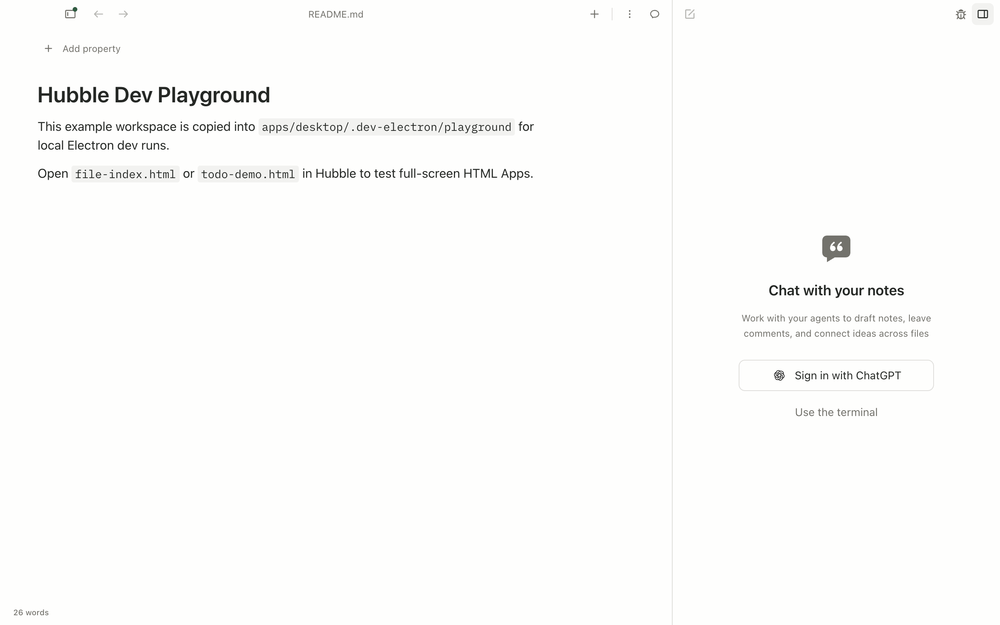

# Chat prototype

Run `pnpm dev:desktop`, then open **Settings → Agents** and choose
**Sign in with ChatGPT**. Complete browser authorization with an eligible ChatGPT
Plus or Pro plan and permission to use that plan. Reconnect, sign-out, and Manage
usage are also in Settings → Agents.

Use the right sidebar button or **⌘⌥B** to open Chat. Select an available model
beside the send arrow. Sending includes the current text file, including unsaved edits,
alongside your message and completed conversation history. The agent can discover,
read, and edit text files in the open workspace.
Stop preserves partial text but excludes it from later context.

## Prototype limits

- Each tab owns its conversation, draft, and model choice. App state persists
  these in localStorage with stable tab IDs. Switching files in a tab, renaming,
  switching workspaces, and restarting preserve them. Closing a tab or signing
  out clears its chat. Switching tabs stops an in-progress reply and preserves
  its partial text as incomplete. Reopening a closed tab starts a new chat.
- One ChatGPT registration per app installation. Reconnect uses the same account
  and registration. Account switching and automatic token renewal are deferred;
  reconnect when the access token expires (normally after an hour).
- File context is captured on send, never while browsing. First use and edits add
  full text snapshots at that turn; unchanged content references an earlier
  snapshot in the same tab. Returning to a file or renaming it reuses identical
  text. Earlier turns remain unchanged to preserve cacheable prefixes. All needed
  history, including snapshots, is transmitted on each HTTP request; caching does
  not remove it from the context window. New chat clears the snapshot history.
- Markdown, HTML, plain text, and code files are supported. Binary files and
  virtual pages are not attached. Sending waits while a text file loads or fails
  to load, so another file's editor buffer cannot be included accidentally.
- Workspace tools are `list_files`, `search_content`, `read_file`, and
  `apply_patch`. File listing and search follow sidebar ignore rules. Reads use
  the live buffer for the open file, including unsaved edits. Each patch updates
  one existing text file, requires the version returned by a read, and rejects
  stale or ambiguous context. Creation, deletion, moves, shell commands, and
  binary edits are outside this prototype.
- Tool paths are workspace-relative. Main resolves paths and checks real paths
  stay inside the workspace, including symlink targets. Each request retains its
  starting workspace and stops if the workspace changes. Tool access remains
  available if native filesystem watching fails. Each watcher start has a unique
  ID so cleanup from an older renderer effect cannot clear the active scope. Edit
  requests instruct the agent to apply changes directly and report success only
  after a successful tool result. Open-file edits use Hubble's existing save queue
  and conflict checks. Workspace activity appears where it happened in the reply.
- Tool results and original response items persist with the conversation and are
  replayed on follow-ups. Completed tool activity remains available after a stop;
  incomplete reply text is excluded. Each turn allows up to 12 model rounds.
- Agent edits save directly. Each edit to an open text editor is one Undo action,
  including front matter in Markdown. Undo and Redo save through the normal editor
  queue. Closed-file edits have no editor history; a review interface is deferred.
- The panel checks the connection before showing a conversation. Signed-out
  accounts see sign-in even when the tab has saved history. Connected accounts
  resume that history or show a new conversation. Missing models and connection
  failures show recovery actions; file-loading failures explain why Send is unavailable.
- Replies render Markdown while streaming, including lists, links, tables, and
  fenced code blocks. Workspace activity appears between text segments in response
  order, including after restoring a chat. New chunks fade in over 140 ms; reduced
  motion disables the animation. Context, including file snapshots and tool results, is capped at
  80,000 characters and 100 messages.
  Oversized chats require a new conversation.

## Connection and credentials

The Electron main process implements the documented public-client OAuth flow:
loopback callback, dynamic registration, PKCE, state and nonce checks, verified
ID-token signature/issuer/audience/expiry, and an account-specific model catalog.
Credentials are encrypted through Electron safeStorage under the app's userData
folder. Linux's plaintext fallback is rejected. The renderer receives account
labels and stream text, never tokens. Sign-out clears local credentials and
attempts refresh-token revocation; a failed remote revocation is reported.

Requests use the public Responses endpoint with `store: false`, `stream: true`,
explicit history, no automatic retry, and no API-key billing fallback. Completion
requires a terminal success event. The OpenAI SDK and jose are used directly; no
Sign in with ChatGPT DevKit source is included.

Protocol references:

- [Open-source sign-in](https://developers.openai.com/siwc/token-sharing-open-source/sign-in)
- [Responses and models](https://developers.openai.com/siwc/token-sharing-open-source/models-and-inference)
- [Accounts and sign-out](https://developers.openai.com/siwc/token-sharing-open-source/profiles-and-sessions)

Unreadable saved credentials show a recovery state in both the panel and Chat
settings. Reset connection and sign in again removes only the local connection,
then starts sign-in. It preserves notes and tab conversations. A failed reset
stays visible with the same retry action.

### Attachments

The selection toolbar attaches a quote pill at the end of the current tab's draft. The comments list and each comment thread attach a thread card above the prompt, previewing its first comment. Attach opens Chat and focuses the composer. Signed-out users see sign-in instead of adding context.

Attachments capture the selection or the thread's highlighted text and comments at attachment time. They stay with the tab across file changes, workspace changes, and restarts. Sending moves them from the draft into that message, preserving the snapshot in later conversation context without attaching another copy on each follow-up. Reattaching the same selection avoids duplicates; reattaching a pending thread refreshes its snapshot. Starting a new chat clears pending attachments.

## Voice drafts (macOS)

The microphone records an editable draft using macOS on-device speech recognition. On supported macOS 26+ devices and languages it uses SpeechAnalyzer and SpeechTranscriber, installing system model assets when needed. Other Macs, unsupported languages, or unavailable model assets fall back to SFSpeechRecognizer, with automatic punctuation on macOS 13+. SpeechAnalyzer revisions replace their explicit audio ranges; the fallback keeps settled utterances separate from partial recognition updates. Audio is processed on device and is not saved. Stop recording to review the transcript and attachments before sending through the existing chat request. The prototype stops after three minutes, rolling recognition sessions over while microphone capture continues; another recording appends to the same draft. Microphone and speech permissions are requested only when starting a recording, with recovery instructions if denied or the current language is unavailable. Other platforms keep the text composer.

During recording, selections in the rich editor attach after staying unchanged for 700 ms. Pointer drags must finish first. Successful attachments briefly flash the selection without moving focus out of the editor; reduced-motion settings suppress the flash. Each voice highlight appears as a truncated pill between the spoken phrases around it, in both the draft and sent message. Speech corrections and draft edits move the pill with its phrase. Sending interleaves each immutable quote with the transcript at that point; editor ranges are local navigation metadata and are not sent to the model. Clicking a pill opens its source in the same tab, selects the original passage, and scrolls it into view. A moved passage is found by its unique text; changed, missing, or ambiguous passages show an error instead of selecting unrelated text. Revealing a pill never auto-attaches it again. Voice highlights can be removed before sending, and highlighting the same passage later creates another interrupt. Switching tabs or workspaces, closing Chat, and signing out stop the recording; partial transcripts remain in the originating tab. A file change inside the same tab keeps recording and attaches subsequent highlights from the new file.

macOS builds require Xcode Command Line Tools. The build compiles a universal Swift helper app with its own privacy descriptions and audio-input entitlements. Launch Services starts it with a private Unix socket back to Hubble so microphone and speech permission belong to Hubble Dictation, even when the dev process was launched from a terminal. macOS Dictation must be enabled in System Settings → Keyboard → Dictation; the helper explains how to recover if it is disabled. The dev wrapper includes the same privacy descriptions.

Speech recognition results can cover only the latest utterance after a pause. Hubble merges words by their timestamps in the recording, keeping earlier utterances and replacing revised overlapping words. Context attachments never restart dictation or clear the draft.

## Chat panel layout

Chat opens by default after the first file opens, and remembers the open or closed preference. Welcome and empty tabs keep it hidden. Single-tab Chat spans the full window height beside the file title bar; with multiple tabs it remains below the tab strip. Changing that layout keeps the panel mounted. Both sidebars share drag resizing and collapse behavior. New windows default to 1200 × 900, clamped to the current display; existing window sizes are preserved.

The composer is a plain-text Tiptap editor with inline quote nodes and the shared yellow virtual cursor. Editing and undo preserve quote anchors. The model picker uses the app's popover menu. The latest tool action stays visible while a reply is running; completed work shows its elapsed duration.

## API payload debugging

The bug button beside Close chat toggles expandable payload details below each message. User turns expose the initial Responses request body; agent turns expose terminal response bodies, transport errors, and later requests made during tool rounds, in order. Captures come from the SDK call and stream events rather than reconstructing requests from visible messages. The latest 50 turns are retained in a file cache in app data, outside saved chat history and subsequent model input, and reloads fetch them on demand. Turns that were never captured expose their saved message input or reply under a distinct label. JSON is formatted only when its dropdown is expanded. Captures include note snapshots, tool results, and replies; they are stored locally without auth headers or tokens and can contain the same sensitive document text as the conversation.
